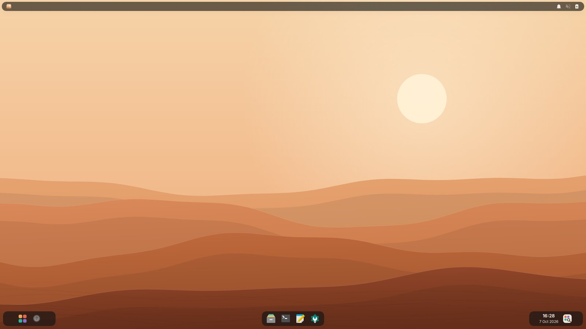
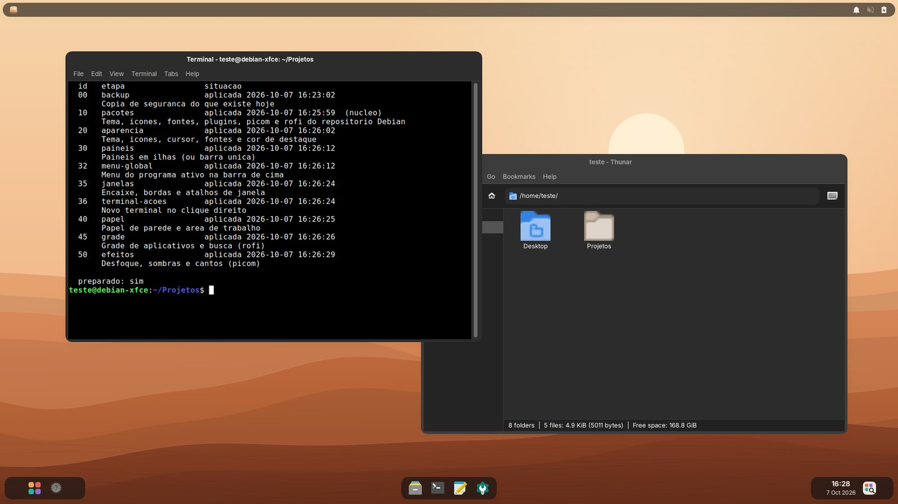
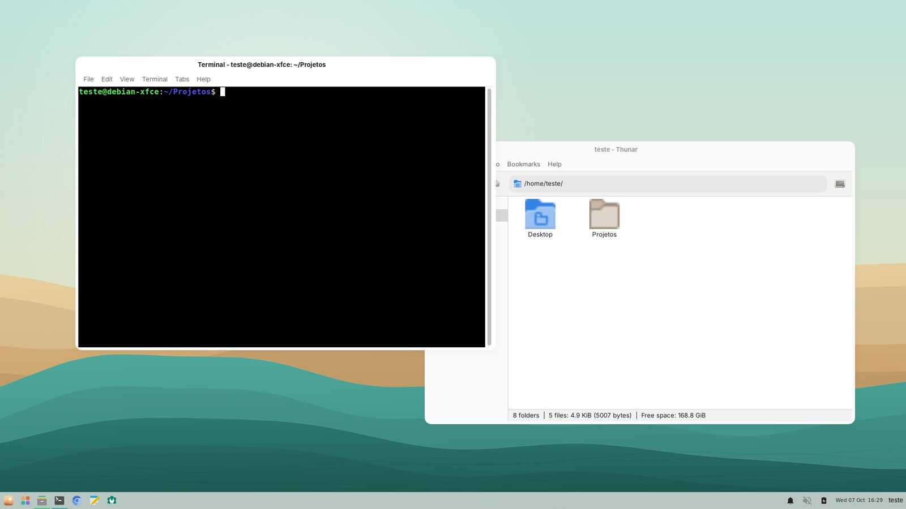
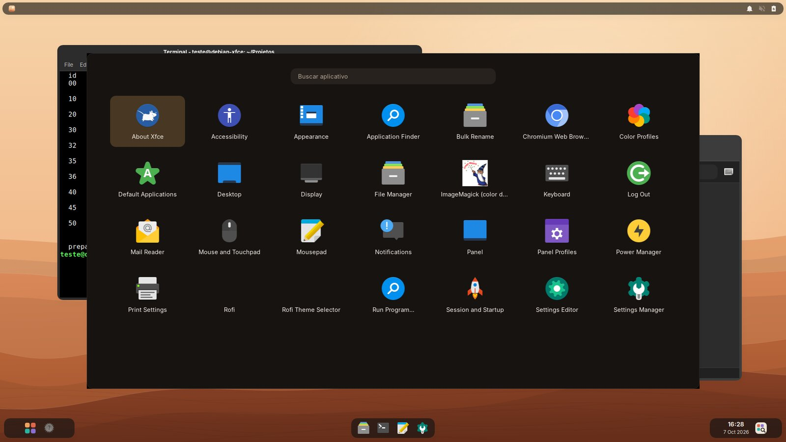
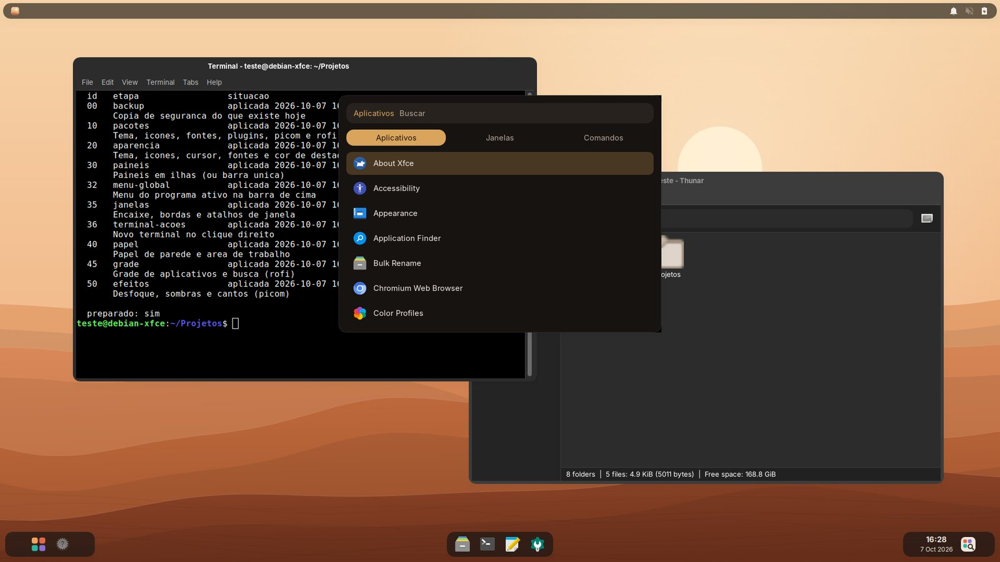
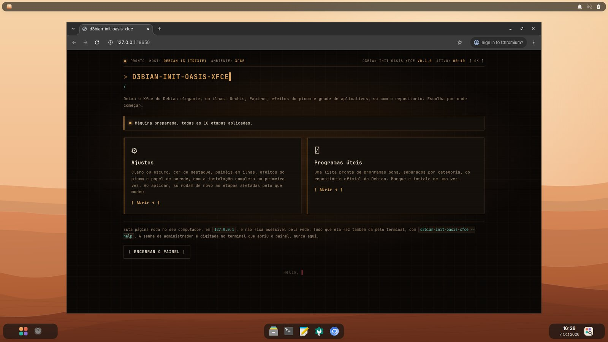
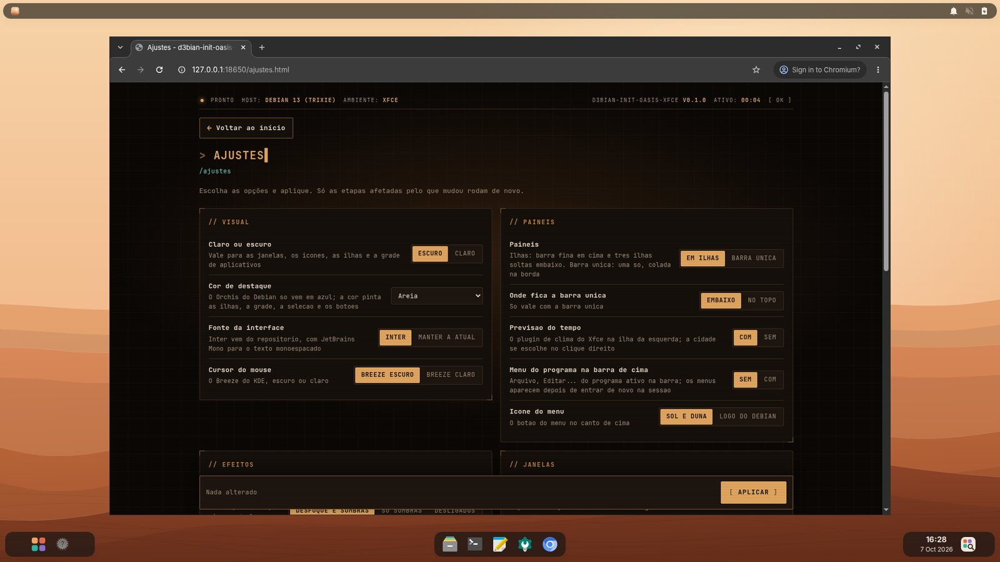

<div align="center">


**O Xfce do Debian em ilhas: painéis soltos, desfoque, grade de aplicativos e dunas, só com o repositório.**

[](docs/desenvolvimento.md)
[](docs/desenvolvimento.md)
[](docs/uso.md#sistemas)
[](docs/uso.md#sistemas)
[](LICENSE)

</div>

> Um painel local, aberto no navegador, que deixa o Xfce 4.20 do Debian 13 com um
> visual macio e quente, **inspirado no visual do DESERT OS Linux**: barra fina em
> cima, três ilhas translúcidas embaixo, desfoque e cantos redondos com o picom,
> grade de aplicativos no rofi e papel de parede de dunas desenhado na hora.
> Tudo vem do **repositório oficial do Debian**: nada é baixado de fora, clonado
> ou compilado. Só Python da biblioteca padrão — nada de pip.

```sh
git clone https://git.saberdl.dev.br/d3bian-temas/oasis-xfce.git d3bian_init_oasis_xfce
python3 -m d3bian_init_oasis_xfce        # pede a senha uma vez e abre o painel
```

<div align="center">
  
</div>

---

## O que ele faz

- **Tema** Orchis (pacote `orchis-gtk-theme`), claro ou escuro, com ícones
  Papirus, cursor Breeze, fonte Inter e JetBrains Mono para o texto monoespaçado
- **Cor de destaque** areia, terracota, oásis ou o azul do próprio Orchis (o
  pacote do Debian só traz o azul; as outras pintam as ilhas, a grade, a seleção
  e os botões por cima do tema)
- **Painéis em ilhas**: barra fina em cima com o menu Whisker, menu global
  opcional, bandeja, som, avisos e bateria; embaixo, soltas da borda, uma ilha
  com a grade e o clima, outra com o dock (`xfce4-docklike-plugin`) e outra com o
  relógio e a busca. Ou uma **barra única**, em cima ou embaixo
- **Efeitos com o picom**: desfoque, sombras, cantos redondos e um esmaecer curto
  ao abrir e fechar; sem aceleração de vídeo (VM sem 3D) ele roda leve, sem
  desfoque, e o painel avisa por quê
- **Grade de aplicativos e busca** no rofi, com tema próprio: Super+A e
  Super+Espaço, ou os botões das ilhas
- **Encaixe de janelas** do próprio xfwm4 (Super e setas, Super+1 a 4, layouts no
  Super+Z), bordas mais largas, e nova janela e nova aba no clique direito do terminal
- **Papel de parede** de dunas ou degradê, em quatro paletas, desenhado no tamanho
  da sua tela
- **Programas úteis**: uma lista pronta do repositório oficial do Debian, conforme o hardware
- **Voltar ao que era antes** com o diário de alterações do [modelo](https://git.saberdl.dev.br/d3bian-temas/modelo)

<!-- imagens: gerado a partir do teste num Debian 13; refazer, nao editar a mao -->
## Telas

As capturas vêm de um Debian 13 com Xfce 4.20 num contêiner de teste (tela
virtual, sem aceleração de vídeo). Por isso o picom roda **leve** (`xrender`):
há cantos redondos e sombras, mas **não há desfoque** atrás das ilhas e das
janelas, como haveria numa máquina com placa de vídeo. O clima mostra `?`
porque o contêiner não tem local configurado.

| Janelas abertas | Claro, cor oásis e barra única |
|---|---|
|  |  |

| Grade de aplicativos (Super+A) | Busca (Super+Espaço) |
|---|---|
|  |  |

| Início | Ajustes |
|---|---|
|  |  |
<!-- fim imagens -->

## Documentação

| | |
|---|---|
| 🚀 [Usando](docs/uso.md) | rodar, opções, atalhos, o que fica onde, sistemas, voltar ao que era antes |
| 🛠️ [Desenvolvimento](docs/desenvolvimento.md) | receitas, ilhas, picom, rofi e papel de parede por dentro |
| ⚙️ [Núcleo](docs/nucleo.md) | o motor, o servidor e as telas comuns a toda a família |

## Família d3bian-init

Todos com o mesmo motor e o mesmo jeito de usar: um painel local, só Python da biblioteca padrão, e "voltar ao que era antes".
Os de terminal ficam em [d3bian-terminal](https://git.saberdl.dev.br/d3bian-terminal); os temas e o modelo, em [d3bian-temas](https://git.saberdl.dev.br/d3bian-temas).

| | Projeto | O que faz |
|---|---|---|
| 💻 | [terminal](https://git.saberdl.dev.br/d3bian-terminal/terminal) · [terminal-kde](https://git.saberdl.dev.br/d3bian-terminal/terminal-kde) | Fish, Oh My Posh, Nerd Font e cores (xfce4-terminal/GNOME Terminal ou Konsole) |
| 💻 | [zsh](https://git.saberdl.dev.br/d3bian-terminal/zsh) · [zsh-kde](https://git.saberdl.dev.br/d3bian-terminal/zsh-kde) | Zsh com sugestões e realce, Oh My Posh, Nerd Font e cores |
| 💻 | [bash](https://git.saberdl.dev.br/d3bian-terminal/bash) · [bash-kde](https://git.saberdl.dev.br/d3bian-terminal/bash-kde) | O bash de sempre, com sugestões e realce, Oh My Posh e Nerd Font |
| 🎨 | [bigsur-kde](https://git.saberdl.dev.br/d3bian-temas/bigsur-kde) · [mactahoe-kde](https://git.saberdl.dev.br/d3bian-temas/mactahoe-kde) | Cara de macOS (Big Sur ou Tahoe) no KDE Plasma 6 |
| 🎨 | [fluent-kde](https://git.saberdl.dev.br/d3bian-temas/fluent-kde) · [chromeos-kde](https://git.saberdl.dev.br/d3bian-temas/chromeos-kde) | Cara de Windows 11 ou de ChromeOS no KDE Plasma 6 |
| 🎨 | [catppuccin-kde](https://git.saberdl.dev.br/d3bian-temas/catppuccin-kde) · [graphite-kde](https://git.saberdl.dev.br/d3bian-temas/graphite-kde) · [layan-kde](https://git.saberdl.dev.br/d3bian-temas/layan-kde) · [orchis-kde](https://git.saberdl.dev.br/d3bian-temas/orchis-kde) | Temas Catppuccin, Graphite, Layan e Orchis no KDE Plasma 6 |
| 🪟 | [bigsur-xfce](https://git.saberdl.dev.br/d3bian-temas/bigsur-xfce) · [bigsur-minimalista-xfce](https://git.saberdl.dev.br/d3bian-temas/bigsur-minimalista-xfce) | Cara de macOS Big Sur no Xfce, completo ou minimalista |
| 🪟 | [minimal-xfce](https://git.saberdl.dev.br/d3bian-temas/minimal-xfce) · [paleta-xfce](https://git.saberdl.dev.br/d3bian-temas/paleta-xfce) | Xfce enxuto, ou numa paleta só (Nord, Gruvbox, Everforest) |
| 🪟 | **oasis-xfce** | Xfce em ilhas, com desfoque do picom, grade no rofi e dunas, só com o repositório |
| 🍎 | [tahoe-gnome](https://git.saberdl.dev.br/d3bian-temas/tahoe-gnome) | Cara de macOS Tahoe no GNOME 48 |
| 🧩 | [modelo](https://git.saberdl.dev.br/d3bian-temas/modelo) | O modelo de onde todos saem: crie o seu próprio d3bian-init |

## Créditos

- Inspirado no visual do [DESERT OS Linux](https://sites.google.com/view/desertoslinux).
  Nada dele é usado: nem nome, nem logo, nem imagem. Os papéis de parede, os ícones
  do menu e da grade e os temas do rofi são desenhados aqui.
- Tudo é instalado do repositório oficial do Debian, cada um com a sua licença:
  [Orchis](https://github.com/vinceliuice/Orchis-theme) (GPL-3.0),
  [Papirus](https://github.com/PapirusDevelopmentTeam/papirus-icon-theme) (GPL-3.0),
  os cursores [Breeze](https://invent.kde.org/plasma/breeze) do KDE (LGPL-3.0 ou posterior),
  as fontes [Inter](https://rsms.me/inter/) e [JetBrains Mono](https://www.jetbrains.com/lp/mono/) (SIL OFL-1.1),
  o [picom](https://github.com/yshui/picom) (MIT e MPL-2.0),
  o [rofi](https://github.com/davatorium/rofi) (MIT) e os plugins do Xfce
  [Whisker Menu](https://docs.xfce.org/panel-plugins/xfce4-whiskermenu-plugin/start) (GPL-2.0),
  [Docklike](https://docs.xfce.org/panel-plugins/xfce4-docklike-plugin/start) (GPL-3.0),
  [Weather](https://docs.xfce.org/panel-plugins/xfce4-weather-plugin/start) (GPL-2.0) e o
  menu global do [vala-panel-appmenu](https://gitlab.com/vala-panel-project/vala-panel-appmenu) (LGPL-3.0).
  O repositório não traz nenhum deles.

---

<div align="center">
<sub>Código sob a <a href="LICENSE">licença MIT</a> · feito para o Debian 13</sub>
</div>
